<p align="center">
  
  <br>
  <strong>🔧 PCOptimizer PRO — Advanced System Monitoring & Optimization</strong>
</p>

<h1 align="center">PCOptimizer PRO</h1>

<p align="center">
  Моніторинг і оптимізація Windows в одному застосунку: 17 розділів — від живих метрик CPU/GPU та чищення сміття до ігрового режиму, лаунчера ігор, бенчмарків, діагностики заліза й загальної оцінки здоров'я системи.
</p>

<p align="center">
  
  
  
  
  <a href="https://github.com/dimaprisaznuk64/PCOptimizer_PRO/actions/workflows/ci.yml"></a>
  
  
</p>

Філософія проєкту: **жодних «секретних» реєстрових твіків і вигаданих +FPS**. Кожна зміна системи робиться лише після бекапу і має кнопку відкату; точку відновлення можна створити додатково вручну. Застосунок працює без адмін-прав — UAC запитується точково, лише для конкретних операцій.

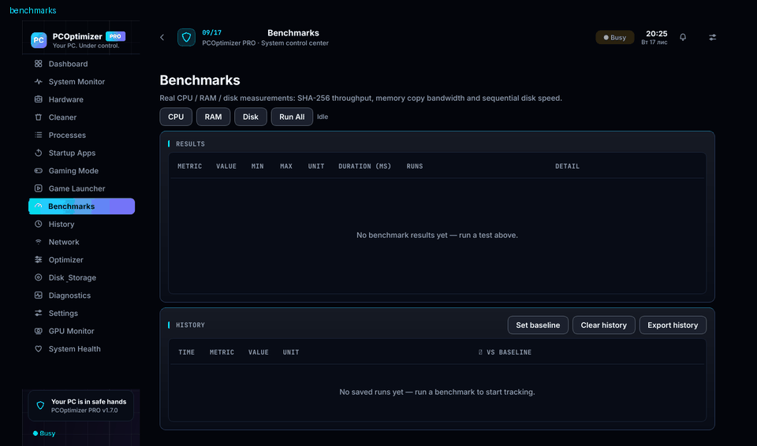

---

## Можливості

### Дашборд
- Живі метрики CPU / RAM / диск / GPU у вигляді кілець та графік продуктивності
- Клік по картці (CPU, RAM, GPU, диск) відкриває сторінку з детальною інформацією
- Привітання, годинник і швидкі дії
- Стрічка останніх дій (чищення, оптимізація, перевірка мережі тощо)
- Сповіщення про завершені операції

### Дизайн та Юзабіліті
- **Cyber HUD** стиль: кутові скоби на картках, фонова HUD-сітка з радіальним свіченням, акцентні заголовки розділів
- **29 тем** з миттєвим перемиканням без перезапуску застосунку
- **Сталая типографія** Inter / JetBrains Mono (однаковий вигляд незалежно від встановленої в системі)
- **Висока контрастність** з optimised для читабельності в темних і світлих темах
- **Розумна ієрархія** з акцентами на важливих даних
- **Семантичне кольорове кодування** для станів, рівнів важливості та типів даних
- **Адаптивний інтерфейс** з 3 режимами компонування (Wide/Mid/Compact)
- **Плавні анімації** переходів між сторінками, появи карток і пульсації HUD-індикаторів
- **Інтуїтивна навігація** з логічним розташуванням елементів
- **Гілкі сенсорів** з підтримкою NVML, WMI ACPI та mock-дані для тестів

### Монітор системи
- CPU: загальне навантаження, історія (180 точок), кожне ядро окремо
- Пам'ять: RAM і swap (поточні значення + історія)
- Мережа: швидкість прийому/передачі, лічильники пакетів
- Накопичувачі та температури (WMI ACPI)

### GPU-монітор (NVIDIA)
- Утилізація ядра, VRAM, температура, споживання (поточне + ліміт), частоти
- Швидкість вентилятора (на більшості ноутбуків NVML її не віддає — показується n/a)
- Підтримка кількох GPU та стійкість до тимчасових помилок NVML (спляча карта)
- Якщо NVIDIA відсутня — сторінка показує причину, застосунок продовжує працювати

### Залізо (Hardware)
- Система, процесор (ядра / потоки / частоти), оперативна пам'ять (модулі, слоти, тип, частота), відеокарти (VRAM уточнюється через NVML), материнська плата, BIOS, накопичувачі (SSD / HDD із WMI та MSFT_PhysicalDisk)
- Розділи зібрані окремо — помилка одного WMI-запиту не ламає всю сторінку

### Менеджер процесів
- Сортування, фільтр і панель деталей
- Завершення процесу з підтвердженням
- Захист критичних системних процесів (System, csrss, explorer, svchost, dwm, власний PID)
- Швидке сканування: важкі поля підтягуються лише при відкритті деталей

### Чистильник
- Попередній скан із розмірами до видалення
- Тимчасові файли, кеші браузерів, шейдер-кеші, кошик
- Пропускає заблоковані файли та дає звіт: скільки звільнено / пропущено

### Автозавантаження
- Джерела: HKCU/HKLM `Run` (+ `WOW6432Node`), папка Startup, Планувальник завдань
- Оцінка впливу на запуск (HIGH / MEDIUM)
- Вимкнення/увімкнення, видалення з бекапом (JSONL) і кнопкою Undo
- Завдання планувальника не видаляються — лише показ

### Оптимізатор Windows
- Профілі: BALANCED / GAMING / PERFORMANCE
- Панель «Що буде змінено»: перед застосуванням показує поточне → цільове значення кожного параметра, позначає незмінені поля та попереджає, що HAGS потребує адмін-прав
- Керує: схемою живлення (powercfg), Game Mode, HAGS, візуальними ефектами
- Перед застосуванням завжди створюється JSON-бекап; точку відновлення можна створити додатково за підтвердженням
- Кнопка Revert повертає збережені значення назад
- Кнопка ручного створення точки відновлення з чесним статусом (створено / Windows пропустив / захист вимкнено / скасовано UAC)
- UAC — лише за потреби (HAGS / HKLM)

### Ігровий режим
- Відомі профілі: PUBG, CS2, Dota 2 + власні ігри
- Автодетект через Steam-бібліотеки (`libraryfolders.vdf`) та Program Files
- Статус встановлено/запущено, кнопка запуску гри
- Увімкнення режиму = профіль GAMING; вимкнення = відкат змін

### Лаунчер ігор
- Плитки ігор з обкладинками Steam, обране та історія запусків
- Steam-ігри запускаються через `steam://rungameid/<appid>` (коректно для anti-cheat і Steam-оверлею), інші — прямим .exe
- Пошук за назвою, фільтр «лише встановлені», сортування (за замовчуванням / нещодавно запущені / найчастіше / назва / обране)

### Бенчмарки
- Реальні вимірювання CPU / RAM / диска: SHA-256 (1 потік + багатопоток, МБ/с), пропускна здатність пам'яті (ГБ/с), послідовний запис/читання диска (МБ/с)
- Кожна метрика — медіана кількох прогонів (з відкинутим прогрівом), у таблиці видно значення, одиниці, тривалість і кількість прогонів
- Диск-тест пише тимчасовий файл у теку даних і прибирає його за собою
- Історія прогонів «до/після оптимізації»: кожен запуск зберігається з часом, можна закріпити базову лінію та бачити зміну у % по кожній метриці (зелене — швидше, червоне — повільніше)
- Експорт історії у CSV / JSON (кнопка «Експорт історії»)

### Мережа
- Ping-тест: 4 запити, середнє й втрати, таблиця результатів
- Діагностика: адаптери, шлюз, DNS, доступ до інтернету, проксі (інформаційно)
- Flush DNS — єдина зміна, і вона безпечна

### Дисковий аналізатор
- Використання дисків із барами
- Скан папки: розміри тек-рівня та рекурсивні, навігація подвійним кліком
- Пошук великих файлів (поріг 100 МБ / 500 МБ / 1 ГБ)

### Діагностика
- Здоров'я накопичувачів (SMART): модель, тип (SSD/HDD), розмір, температура, знос, наробіток, помилки читання/запису, стан
- Журнал подій Windows у режимі лише читання: System / Application, фільтр за рівнем (критичні / помилки / попередження), таблиця час–рівень–джерело–ID–повідомлення
- Усе через PowerShell, працює без прав адміністратора; права не змінюються

### Історія продуктивності
- Запис метрик (CPU, RAM, GPU, температура) з тротлінгом кожні 30 с, автообрізання старших за 24 год
- Діапазони 1 год / 6 год / 24 год, картки статистики (поточне / середнє / пік) і графіки по кожній метриці
- Дані зберігаються в теці застосунку (`data/performance_history.jsonl`)

### PC Health Score
- Загальна оцінка 0–100 і грейд
- Findings: RAM, температури, диски, автозавантаження, живлення, сміття — з рівнями важливості
- Дія на кожен рядок: «Виправити» (сміття, план живлення, важкі автозапуски — з підтвердженням) або «Перейти» на потрібну сторінку (кошик/моніторинг)
- Fix All: чистить сміття (кошик не чіпає) та автоматично пересканює систему
- Експорт звіту сканування у CSV / JSON (кнопка «Експорт звіту»)

### Налаштування
- Інтервал семплінгу: 250 мс – 5 с
- Трей: згортання у трей, старт згорнутим, метрики в тултіпі
- Температурні алерти: сповіщення в трей і журнал дій при перегріванні CPU (90 °C) / GPU (87 °C); повтор не частіше ніж раз на 5 хв; під час гри CPU/GPU-алерти тихо пригнічуються
- Рівень логів і перегляд логів (відкрити папку, очистити)
- 29 тем (перемикаються миттєво, без перезапуску): Titanium (за замовчуванням), Graphite, True Black, Slate, Forest, Burgundy, Midnight, Aubergine, Deep Teal, Espresso, Arctic, Ivory, Mono, Sage, Performance Red, Cyber, Industrial, Tactical, Cobalt, Copper, Minimal Dark, Neon Pulse, Nexus, Electric, а також класичні Black Cyber, Purple Neon, Green Nature, Light, AMOLED Neon
- Вбудовані шрифти **Inter** (UI) та **JetBrains Mono** (числові значення) — однаковий вигляд незалежно від того, що встановлено в системі
- Мова: українська / English — застосовується одразу
- Перевірка оновлень: автоматично при старті (можна вимкнути) або кнопкою «Перевірити зараз» — показує версію, посилання на реліз і сповіщає в трей та журнал дій; кнопка «Завантажити інсталятор» приймає лише HTTPS GitHub, перевіряє redirection і MZ-заголовок .exe та зберігає файл у теці даних застосунку (ніколи не запускає його)

### Поза сторінками
- Системний трей: відкрити, ігровий режим, вихід, сповіщення
- Трей-алерти з cooldown: перегрів CPU/GPU, високе навантаження CPU/RAM (90%) і майже повний диск (92%); пороги фіксовані й безпечні
- Експорт звітів здоров'я та історії бенчмарків у CSV, JSON і PDF (PDF — через Qt, без додаткових пакетів)
- Single instance: повторний запуск лише фокусує вже відкрите вікно
- Ротаційні логи (1 МБ × 3) у теці даних застосунку (data/logs, див. нижче)
- Шар сенсорів: psutil / NVML / WMI ACPI + mock-бекенд для тестів

---

## Архітектура

```text
main.py
  └─ app/ui/                 PySide6: MainWindow, 17 сторінок, теми, трей, QSS/токени
       ├─ SensorSampler ──── app/sensors/  (psutil / NVML / WMI ACPI / mock)
       └─ Task (QThread) ─── app/<domain>/service.py
                              ├─ cleaner, processes, startup, optimizer, restore
                              ├─ gaming, launcher, benchmarks, history, reports
                              ├─ diagnostics, hardware, disk, network, alerts
                              └─ settings, logs, i18n

Потік даних: сенсор → Snapshot → MainWindow.handle_snapshot → сторінки + трей + PerformanceHistory
Потік дій:   UI → Task → Service → backup/restore point → застосування → ActivityLog → UI
Дані:        PCOPTIMIZER_DATA / <exe>/data / <project>/data (портативно, з міграцією з %LOCALAPPDATA%)
```

Для портфоліо є компактний статичний лендинг: [docs/landing.html](docs/landing.html).

Сервіси не залежать від Qt і приймають зовнішні залежності через конструктор — завдяки цьому бенчмарки, WMI, PowerShell, реєстр і навіть NVML підміняються фейками в тестах. UI лише викликає сервіси у фонових `Task` і ніколи не блокує event loop.

---

## Скріншоти

| Дашборд | Монітор системи |
| --- | --- |
| 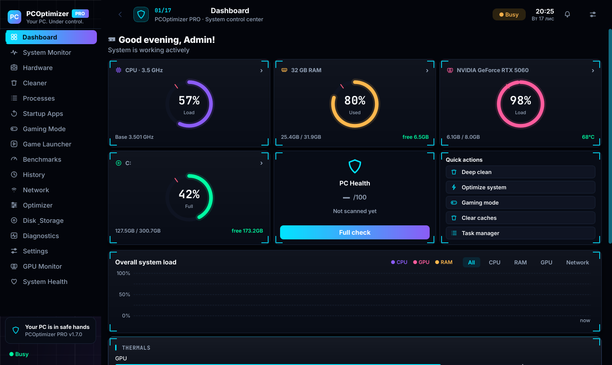 | 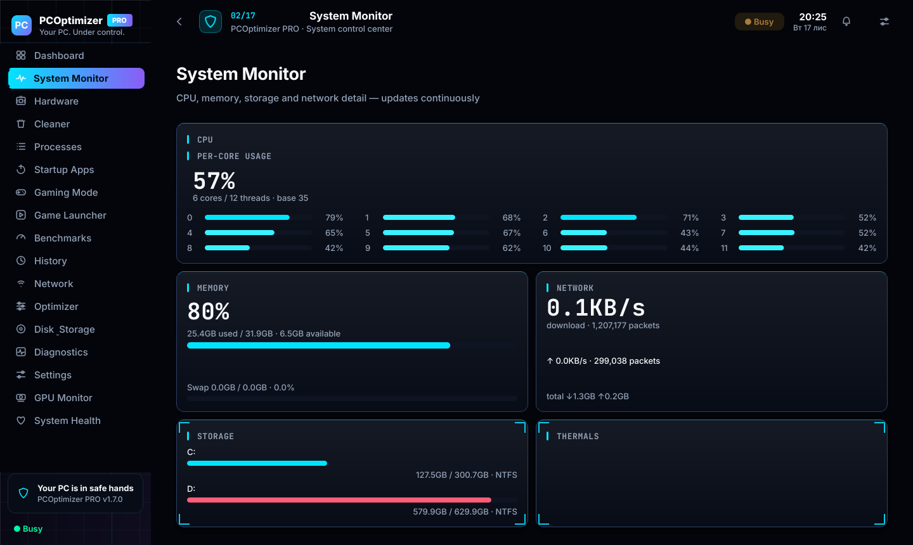 |

| Залізо (Hardware) | GPU-монітор |
| --- | --- |
| 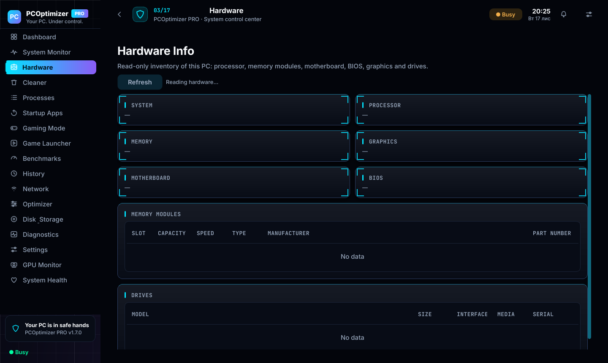 | 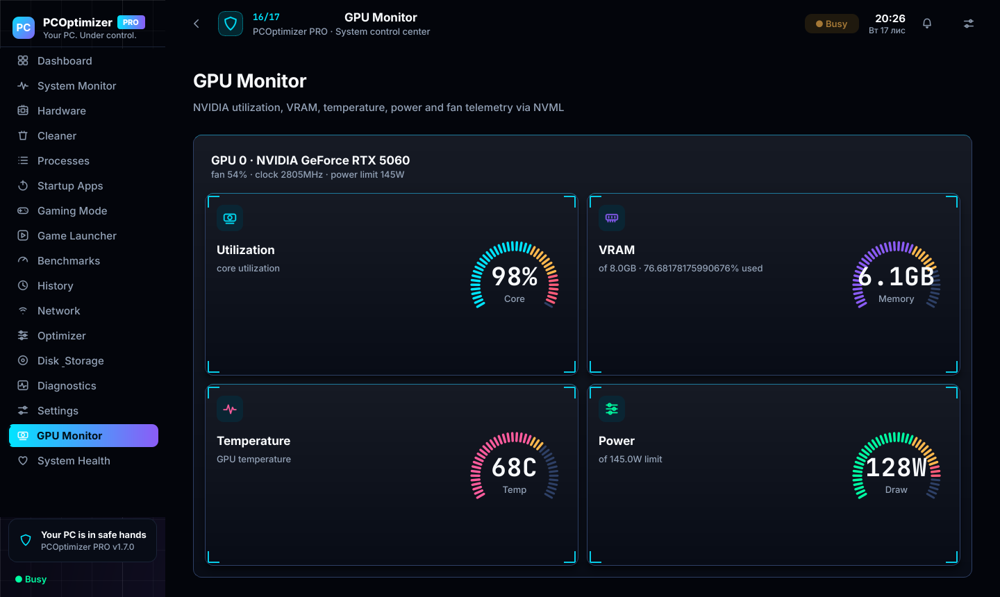 |

| PC Health Score | Чистильник |
| --- | --- |
| 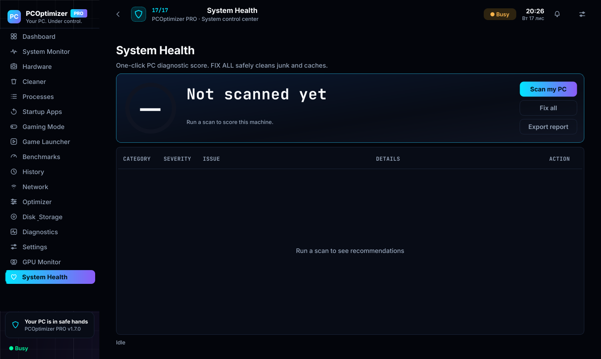 | 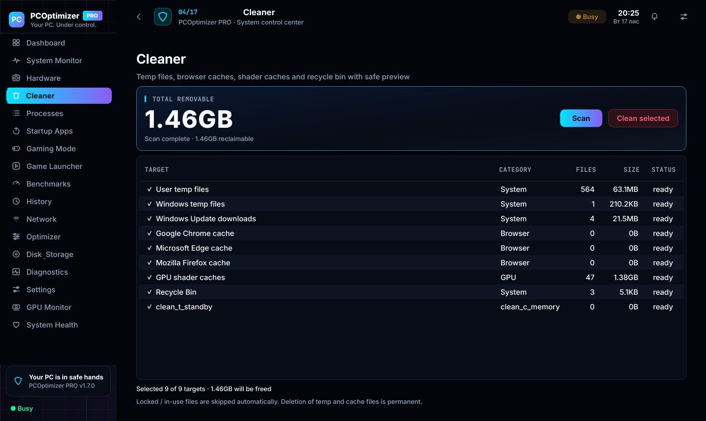 |

| Ігровий режим | Лаунчер ігор |
| --- | --- |
| 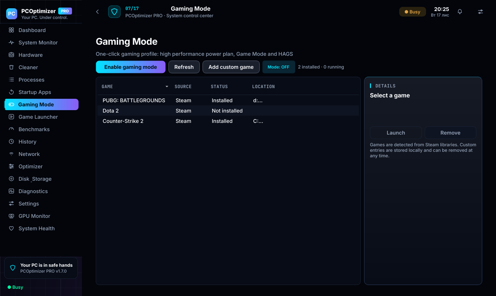 | 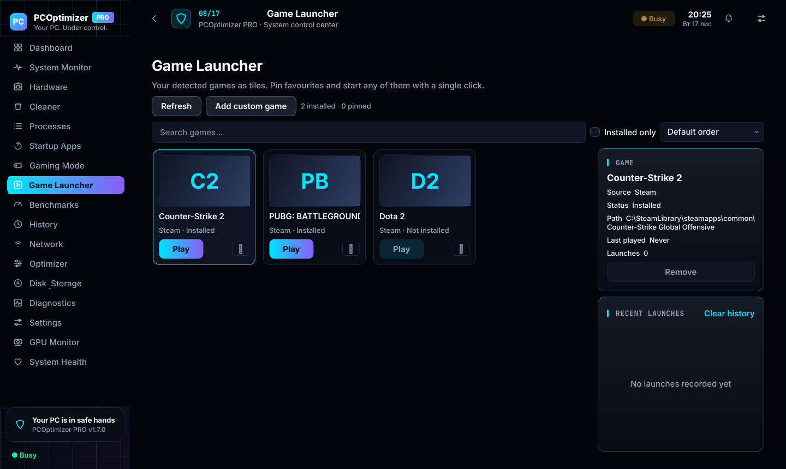 |

| Бенчмарки | Мережа |
| --- | --- |
| 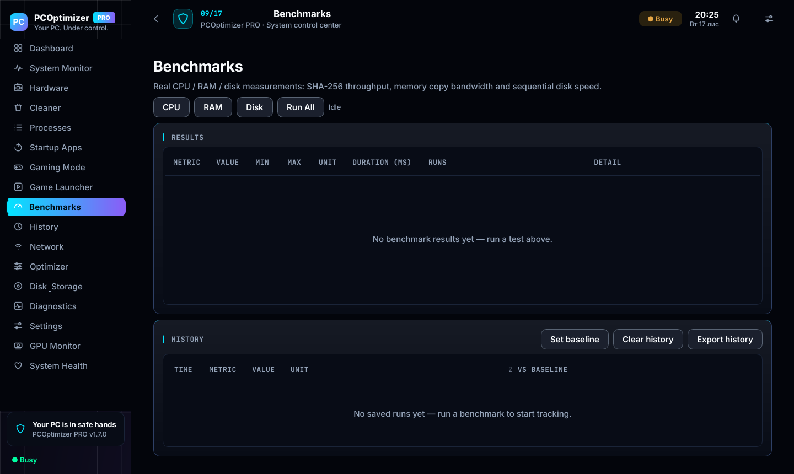 | 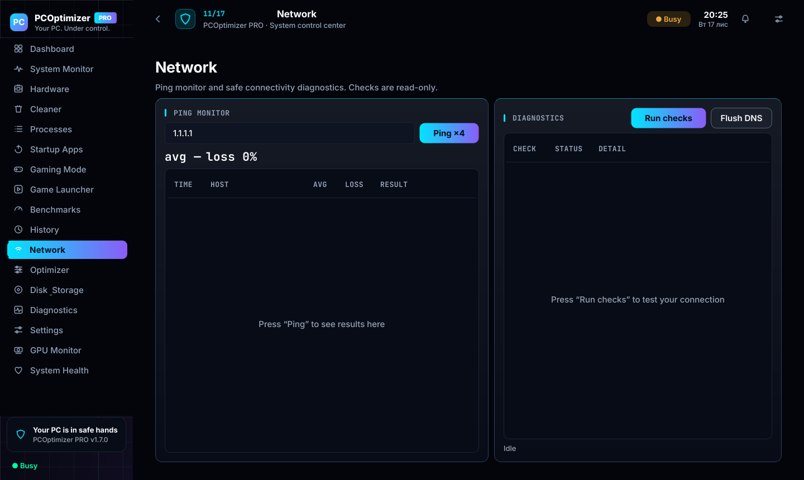 |

| Діагностика | Диски та сховище |
| --- | --- |
| 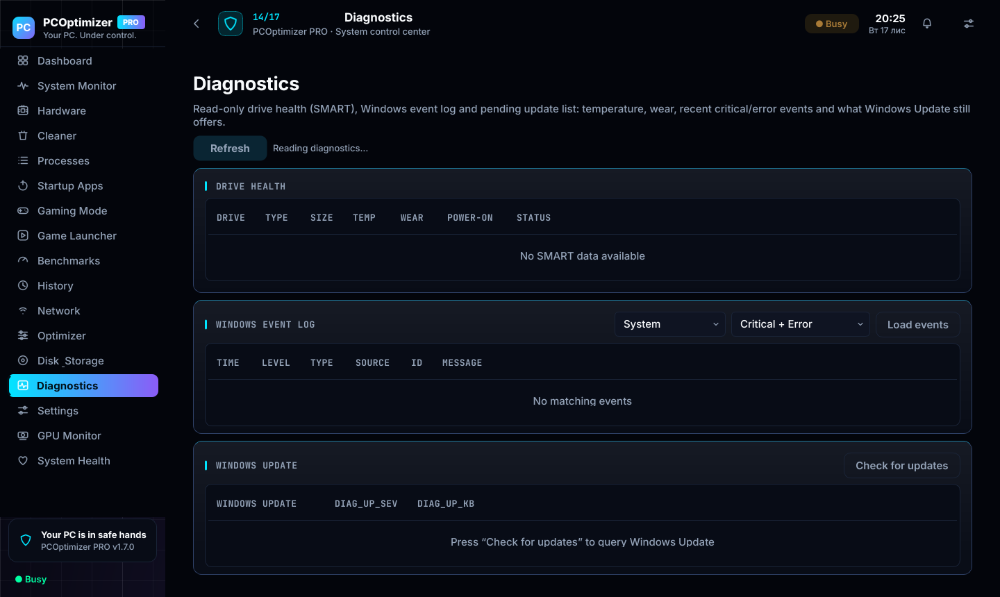 | 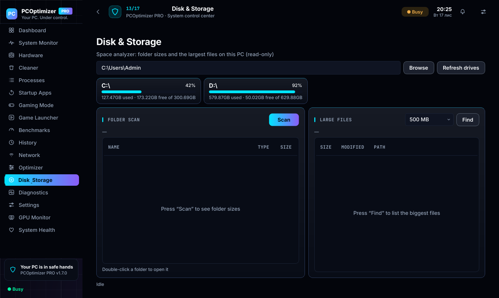 |

Решта сторінок (Огляд, Процеси, Автозавантаження, Історія продуктивності, Налаштування): [docs/screenshots](docs/screenshots)

---

## Технології

- **Python 3.13** + **PySide6** (Qt 6; 29 вбудованих тем, тема за замовчуванням — Titanium, вбудовані шрифти Inter / JetBrains Mono)
- **psutil** — CPU/RAM/диски/мережа, **nvidia-ml-py** (NVML) — GPU, **WMI** — температури, **pywin32** — COM/Task Scheduler/кошик
- **pytest** — 615 тестів
- **PyInstaller** — збірка .exe, **Inno Setup** — інсталятор

## Безпека понад усе

- Ніяких «секретних» реєстрових твіків і псевдооптимізацій
- Кожна зміна: бекап → застосування → доступний відкат
- Точка відновлення створюється окремо, за вашим підтвердженням
- Застосунок працює без адмін-прав; UAC піднімається лише для конкретної операції
- Реальні виміри замість обіцянок «+100500 FPS»

## Встановлення

**Варіант 1 — інсталятор.** Запустити `PCOptimizer_PRO_Setup_1.7.0.exe`.
Встановлюється для поточного користувача (без прав адміністратора), мови EN/UA, створює ярлики та деінсталятор.

> Якщо Windows показує «Windows protected your PC» (SmartScreen) — це нормально для непідписаних програм: **More info → Run anyway**. Так само деякі антивіруси можуть хибно реагувати на PyInstaller-збірки.

**Варіант 2 — портативно.** Розпакувати `PCOptimizer_PRO_1.7.0_portable.zip` і запустити `PCOptimizer_PRO\PCOptimizer_PRO.exe`. Нічого не встановлюється.

Готові збірки — у розділі [Releases](https://github.com/dimaprisaznuk64/PCOptimizer_PRO/releases).

## Запуск з джерел

Потрібен Python 3.13 (Windows 10/11 x64).

```bash
pip install -r requirements.txt
python main.py
```

Тести:

```bash
pip install -r requirements-dev.txt
python -m pytest tests
```

## Збірка

```powershell
# .exe (PyInstaller, onedir) → dist\PCOptimizer_PRO\
powershell -ExecutionPolicy Bypass -File scripts\build_exe.ps1

# інсталятор (потрібен Inno Setup 6) → dist\installer\
powershell -ExecutionPolicy Bypass -File scripts\build_installer.ps1
```

## Структура проєкту

```
main.py                  — точка входу
app/
  ui/                    — PySide6 UI: 17 сторінок, теми, трей, topbar
  sensors/               — шар сенсорів: psutil / NVML / WMI / mock
  health/                — PC Health Score
  benchmarks/            — швидкі тести CPU / RAM / диска
  history/               — історія продуктивності (JSONL + графіки)
   reports/               — експорт звітів у CSV / JSON / PDF
   alerts/                — температурні та resource-алерти (CPU/RAM/диск)
  cleaner/               — чистильник
  disk/                  — дисковий аналізатор
  gaming/                — ігровий режим і профілі ігор
  network/               — ping і діагностика мережі
  optimizer/             — профілі оптимізації Windows
  processes/             — менеджер процесів
  startup/               — менеджер автозавантаження
  restore/               — бекапи та відкат
  settings/              — налаштування (дані в data/ поруч із exe)
  logs/                  — ротаційне логування
  i18n/                  — локалізація UA / EN
  core/, hardware/, monitor/, health/, diagnostics/, alerts/, benchmarks/, gaming/ — допоміжні модулі
tests/                   — pytest-тести (615)
scripts/                 — збірка exe/інсталятора, генерація іконки
installer/               — скрипт Inno Setup
docs/screenshots/        — скріншоти
```

## Локалізація

Українська (основна) та англійська. Перемикається в Налаштуваннях і застосовується одразу, без перезапуску.

## Сумісність

- Windows 10/11 x64
- GPU-сторінки — для NVIDIA (NVML); без NVIDIA застосунок працює, а сторінки показують пояснення
- Адмін-права не потрібні; UAC — точково (HAGS, схеми живлення)

## Дорожня карта

- Overlay (FPS/CPU) поверх гри
