<p align="center">
  
  <br>
  <strong>🔧 PCOptimizer PRO — Advanced System Monitoring & Optimization</strong>
</p>

<h1 align="center">PCOptimizer PRO</h1>

<p align="center">
  Моніторинг і оптимізація Windows в одному застосунку: 23 розділи — від живих метрик CPU/GPU та чищення сміття до ігрового режиму, лаунчера ігор, бенчмарків, діагностики заліза й загальної оцінки здоров'я системи.
</p>

<p align="center">
  
  
  
   
  <a href="https://github.com/dimaprisaznuk64/PCOptimizer_PRO/actions/workflows/ci.yml"></a>
  
  
</p>

Філософія проєкту: **жодних «секретних» реєстрових твіків і вигаданих +FPS**. Кожна зміна системи робиться лише після бекапу і має кнопку відкату; точку відновлення можна створити додатково вручну. Застосунок працює без адмін-прав — UAC запитується точково, лише для конкретних операцій.


---

## Можливості

### Дашборд
- 4 зони: **Огляд**, **Моніторинг та історія**, **Система**, **Активність і рекомендації**
- Живі метрики CPU / RAM / диск / GPU у вигляді кілець, окрема плитка температури та графік продуктивності
- Графік історії за останню годину з файлу `performance_history.jsonl`
- Рекомендації з реальних метрик (високий CPU/GPU, перегрів, малий диск, низький Health Score) з переходом на потрібну сторінку
- Клік по картці (CPU, RAM, GPU, диск) відкриває сторінку з детальною інформацією
- Стрічка останніх дій, сповіщення та швидкі дії

### Дизайн та Юзабіліті
- **Cyber HUD** стиль: кутові скоби на картках, фонова HUD-сітка з радіальним свіченням, акцентні заголовки розділів
- **18 тем** з миттєвим перемиканням без перезапуску застосунку (старі назви працюють як аліаси)
- **Сталая типографія** Geist / Geist Mono (однаковий вигляд незалежно від встановленої в системі)
- **Висока контрастність** з optimised для читабельності в темних і світлих темах
- **Розумна ієрархія** з акцентами на важливих даних
- **Семантичне кольорове кодування** для станів, рівнів важливості та типів даних
- **Адаптивний інтерфейс** з 3 режимами компонування (Wide/Mid/Compact)
- **Плавні анімації** переходів між сторінками, появи карток і пульсації HUD-індикаторів
- **Інтуїтивна навігація** з 7 групами, що згортаються (стан зберігається після зміни теми, compact-режиму та мови)
- **Глобальний пошук сторінок** (Ctrl+K або кнопка в топбарі): пошук за назвою, групою та описом, нещодавні сторінки, керування стрілками/Enter/Esc
- **Центр сповіщень** (кнопка дзвінка в топбарі): усі події з лічильником непрочитаних, фільтри «Усі / Непрочитані / Попередження та помилки», позначення прочитаними та очищення; стан прочитання зберігається між запусками
- **Центр операцій** (група «Огляд»): 200 останніх дій застосунку з підсумком, пошуком, фільтрами за рівнем і часом, деталями, експортом CSV/JSON та переходом на сторінку-джерело
- **Майстер першого запуску**: 3 кроки для вибору мови, теми, масштабу, алертів і поведінки трею; для нових інсталяцій запускається автоматично, повторно доступний через Налаштування
- **Контекстні меню в таблицях**: процеси, автозавантаження, чистильник і центр операцій мають правоклік з дією по рядку, копіюванням значень і швидкими переходами
- **Кастомізація дашборду**: вибір віджетів у Налаштуваннях; приховані секції автоматично зникають, а стан зберігається в портативному `data/`
- **Гілкі сенсорів** з підтримкою NVML, WMI ACPI та mock-дані для тестів

### Монітор системи
- CPU: загальне навантаження, історія (180 точок), кожне ядро окремо
- Пам'ять: RAM і swap (поточні значення + історія)
- Піки сесії для CPU, RAM і системної температури
- Commit charge / віртуальна пам'ять Windows (`GlobalMemoryStatusEx`), якщо джерело доступне
- Таблиця «Top RAM processes»: 5 найбільших споживачів пам'яті з оновленням кожні 5 с
- Мережа: швидкість прийому/передачі, лічильники пакетів
- Накопичувачі та температури (WMI ACPI; додатково LibreHardwareMonitor через pythonnet, якщо DLL і права адміністратора доступні)

### GPU-монітор (NVIDIA)
- Утилізація ядра, VRAM, температура, споживання (поточне + ліміт), частоти
- Гаряча точка (hotspot) і частота пам'яті, якщо NVML їх віддає
- Піки сесії для температури, гарячої точки та споживання
- Причини обмеження частот NVML показуються чесно (`clock limited` + `0x...`), без вигаданого «thermal throttling»
- Швидкість вентилятора (на більшості ноутбуків NVML її не віддає — показується n/a)
- Підтримка кількох GPU та стійкість до тимчасових помилок NVML (спляча карта)
- Якщо NVIDIA відсутня — сторінка показує причину, застосунок продовжує працювати

### Залізо (Hardware)
- Система, процесор (ядра / потоки / частоти), оперативна пам'ять (модулі, слоти, тип, частота), відеокарти (VRAM уточнюється через NVML), материнська плата, BIOS, накопичувачі (SSD / HDD із WMI та MSFT_PhysicalDisk)
- Розділи зібрані окремо — помилка одного WMI-запиту не ламає всю сторінку

### Панель температур
- Живі показання з LibreHardwareMonitor (CPU / материнська плата / GPU), ACPI-зон (системна температура), NVIDIA GPU та hotspot; застарілі NVML-значення ігноруються
- LHM читається через pythonnet з DLL у `assets/lib/lhm`; для доступу до апаратних сенсорів потрібен запуск від адміністратора. Якщо плата не віддає температуру (наприклад, 0 °C або порожній набір), панель чесно показує «—»
- **HWiNFO Shared Memory** (найвищий пріоритет): якщо LHM не бачить CPU або материнську плату (типово для Ryzen + деякі плати), запустіть HWiNFO із вікном Sensors від адміністратора й увімкніть *Shared Memory Support*. Пріоритет джерел: HWiNFO → LHM (pythonnet) → LHM WMI → ACPI. У безкоштовній версії HWiNFO Shared Memory вимикається через 12 год — застосунок покаже підказку «перезапустіть HWiNFO», а застарілі дані (HWiNFO завис) ігноруються
- Температура диска (S.M.A.R.T.) показується окремим рядком «Диск», а не як «Система»
- Історія 1 год / 6 год / 24 год / 7 днів із піком, середнім, максимумом і статусом за порогами
- Окремий Refresh інвалідує кеш історії; піки сесії зберігаються при перемиканні мови
- чесно показує відсутність джерела: немає вигаданої температури CPU, якщо Windows її не віддає

### Менеджер процесів
- Сортування, фільтр і панель деталей
- Завершення процесу з підтвердженням
- Захист критичних системних процесів (System, csrss, explorer, svchost, dwm, власний PID)
- Швидке сканування: важкі поля підтягуються лише при відкритті деталей

### Чистильник
- Попередній скан із розмірами до видалення
- Тимчасові файли, кеші браузерів, шейдер-кеші, кошик, WER, crash dumps, pip/npm
- Вайтлист шляхів: виключені каталоги не скануються й не видаляються
- Мінімальний вік файлу для обраних цілей; у прев'ю видно причини пропуску й деталі скану
- Розклад нагадувань (щодня / щотижня / щомісяця) — без авто-видалення
- Рештки програм і попередній перегляд великих файлів (>100 МБ) як окремі цілі
- Пропускає заблоковані файли та дає звіт: скільки звільнено / пропущено


### Автозавантаження
- Джерела: HKCU/HKLM `Run` (+ `WOW6432Node`), папка Startup, Планувальник завдань
- Оцінка впливу на запуск (HIGH / MEDIUM)
- Вимкнення/увімкнення, видалення з бекапом (JSONL) і кнопкою Undo
- Завдання планувальника не видаляються — лише показ

### Оптимізатор Windows
- Профілі: BALANCED / GAMING / PERFORMANCE
- Панель «Що буде змінено»: перед застосуванням показує поточне → цільове значення кожного параметра, позначає незмінені поля та попереджає, що HAGS потребує адмін-прав
- Керує: схемою живлення (powercfg), Game Mode, HAGS, візуальними ефектами
- Перед застосуванням завжди створюється JSON-бекап; точку відновлення можна створити додатково за підтвердженням
- Кнопка Revert повертає збережені значення назад
- Кнопка ручного створення точки відновлення з чесним статусом (створено / Windows пропустив / захист вимкнено / скасовано UAC)
- UAC — лише за потреби (HAGS / HKLM)

### Ігровий режим
- Відомі профілі: PUBG, CS2, Dota 2, ARC Raiders + власні ігри
- Автодетект через Steam-бібліотеки (`libraryfolders.vdf`) та Program Files
- Статус встановлено/запущено, кнопка запуску гри
- Власний профіль оптимізації для кожної гри (BALANCED / GAMING / PERFORMANCE)
- Вимкнення = відкат змін; стан режиму зберігається окремо від бекапу оптимізатора
- Сесія телеметрії: FPS, середній frametime, 1% / 0.1% lows, CPU/RAM/GPU та температури «до/після», історія сесій
- Графік порівняння сесій: CPU/RAM/GPU/температура «до/після», окремий перегляд FPS по сесіях і середня зміна з напрямком
- Джерело FPS — інжектований PresentMon-подібний CSV-провайдер; без нього сторінка чесно показує недоступність даних. Оверлею та ін'єкцій у гру немає

### Лаунчер ігор
- Плитки ігор з обкладинками Steam, обране та історія запусків
- Steam-ігри запускаються через `steam://rungameid/<appid>` (коректно для anti-cheat і Steam-оверлею), інші — прямим .exe
- Пошук за назвою, фільтр «лише встановлені», сортування (за замовчуванням / нещодавно запущені / найчастіше / назва / обране)

### Бенчмарки
- Реальні вимірювання CPU / RAM / диска: SHA-256 (1 потік + багатопоток, МБ/с), пропускна здатність пам'яті (ГБ/с), послідовний запис/читання диска (МБ/с)
- Кожна метрика — медіана кількох прогонів (з відкинутим прогрівом), у таблиці видно значення, одиниці, тривалість і кількість прогонів
- Диск-тест пише тимчасовий файл у теку даних і прибирає його за собою
- Історія прогонів «до/після оптимізації»: кожен запуск зберігається з часом, можна закріпити базову лінію та бачити зміну у % по кожній метриці (зелене — швидше, червоне — повільніше)
- Експорт історії у CSV / JSON (кнопка «Експорт історії»)

### Бенчмарк заліза
- один запуск CPU, RAM і диска разом із конфігурацією системи (процесор, пам'ять, GPU, сховище)
- таблиця результатів і порівняння зі збереженою базовою лінією: попереднє значення, поточне та зміна у %
- кнопка «Встановити базу» закріплює поточний прогон для кожної метрики
- експорт звіту маскує hostname, серійні номери плати та дисків за замовчуванням; включення ідентифікаторів — явний opt-in

### Мережа
- Ping-тест: 4 запити, середнє й втрати, таблиця результатів
- Діагностика: адаптери, шлюз, DNS, доступ до інтернету, проксі (інформаційно)
- Flush DNS — єдина зміна, і вона безпечна

### Дисковий аналізатор
- Використання дисків із барами
- Скан папки: розміри тек-рівня та рекурсивні, навігація подвійним кліком
- Пошук великих файлів (поріг 100 МБ / 500 МБ / 1 ГБ)

### Діагностика
- Здоров'я накопичувачів (SMART): модель, тип (SSD/HDD), розмір, температура, знос, наробіток, помилки читання/запису, стан
- Журнал подій Windows у режимі лише читання: System / Application, фільтр за рівнем (критичні / помилки / попередження), таблиця час–рівень–джерело–ID–повідомлення
- Перевірка системних файлів лише на читання: `DISM /ScanHealth` та `sfc /verifyonly` (нічого не відновлюється автоматично)
- Окрема таблиця драйверів пристроїв і проблемних кодів
- Підсумок рекомендацій з важливістю: диски, події, системні файли, драйвери, помилки опитування
- Усе через PowerShell, працює без прав адміністратора; права не змінюються

### Драйвери
- Перелік підписаних драйверів Windows (`Win32_PnPSignedDriver`): пристрій, клас, виробник, версія, дата, постачальник, стан
- Лише читання: застосунок не встановлює, не оновлює й не видаляє драйвери

### Звіт системи
- Збір збережених даних про систему, залізо, здоров'я, оптимізатор, точки відновлення, бенчмарки, історію та діагностику
- Формат HTML або текст, попередній перегляд і збереження у файл
- Серійні номери та імена машин маскуються за замовчуванням; явний чекбокс дозволяє їх включити
- Секрети (паролі, токени, Authorization/Bearer) маскуються завжди, навіть за згодою на ідентифікатори

### Центр експорту
- одне місце для експорту звітів здоров'я, бенчмарків, діагностики, історії продуктивності та системного звіту
- формати CSV / JSON / HTML / PDF там, де їх підтримує конкретний звіт; вибір папки призначення
- попередній перегляд показує вибрані експорти, записані файли, розмір і кількість сторінок PDF
- часткова помилка не приховує вже записані файли — статус і preview показують успіх і помилки окремо

### Історія продуктивності
- Запис метрик (CPU, RAM, GPU, температура, hotspot, частота пам'яті, живлення, commit charge) з тротлінгом кожні 30 с
- Автообрізання старших за 7 днів і періодична компакція файлу
- Діапазони 1 год / 6 год / 24 год / 7 днів, картки статистики (поточне / середнє / пік) і графіки по кожній метриці
- Історія топ процесів за RAM: останнє значення, пік і кількість зразків для кожного процесу
- Дані зберігаються в теці застосунку (`data/performance_history.jsonl`)

### PC Health Score
- Загальна оцінка 0–100 і грейд
- Findings: RAM, температури, диски, автозавантаження, живлення, сміття — з рівнями важливості
- Дія на кожен рядок: «Виправити» (сміття, план живлення, важкі автозапуски — з підтвердженням) або «Перейти» на потрібну сторінку (кошик/моніторинг)
- Fix All: чистить сміття (кошик не чіпає) та автоматично пересканює систему
- Експорт звіту сканування у CSV / JSON (кнопка «Експорт звіту»)

### Налаштування
- Інтервал семплінгу: 250 мс – 5 с
- Трей: згортання у трей, старт згорнутим, метрики в тултіпі
- Температурні алерти: сповіщення в трей і журнал дій при перегріванні CPU (90 °C) / GPU (87 °C); повтор не частіше ніж раз на 5 хв; під час гри CPU/GPU-алерти тихо пригнічуються
- Рівень логів і перегляд логів (відкрити папку, очистити)
- 18 тем (перемикаються миттєво, без перезапуску): Titanium (за замовчуванням), Graphite, True Black, Forest, Burgundy, Midnight, Aubergine, Espresso, Arctic, Ivory, Mono, Sage, Cyber, Industrial, Tactical, Purple Neon, Green Nature, AMOLED Neon. Старі назви (Slate, Cobalt, Deep Teal, Performance Red, Copper, Black Cyber, Light, Minimal Dark, Neon Pulse, Nexus, Electric тощо) збережені як аліаси — налаштування не ламаються
- Вбудовані шрифти **Geist** (UI) та **Geist Mono** (числові значення) — однаковий вигляд незалежно від того, що встановлено в системі
- Мова: українська / English — застосовується одразу
- Перевірка оновлень: автоматично при старті (можна вимкнути) або кнопкою «Перевірити зараз» — показує версію, посилання на реліз і сповіщає в трей та журнал дій; кнопка «Завантажити інсталятор» приймає лише HTTPS GitHub, перевіряє redirection, MZ-заголовок .exe та SHA-256 релізу, зберігає файл у теці даних застосунку (ніколи не запускає його)

### Поза сторінками
- Системний трей: відкрити, ігровий режим, вихід, сповіщення
- Трей-алерти з cooldown: перегрів CPU/GPU, високе навантаження CPU/RAM (90%) і майже повний диск (92%); пороги фіксовані й безпечні
- Експорт звітів здоров'я та історії бенчмарків у CSV, JSON і PDF (PDF — через Qt, без додаткових пакетів)
- Single instance: повторний запуск лише фокусує вже відкрите вікно
- Ротаційні логи (1 МБ × 3) у теці даних застосунку (data/logs, див. нижче)
- Шар сенсорів: psutil / NVML / WMI ACPI + mock-бекенд для тестів

---

## Архітектура

```text
main.py
  └─ app/ui/                 PySide6: MainWindow, 23 сторінки, теми, трей, QSS/токени
       ├─ SensorSampler ──── app/sensors/  (psutil / NVML / WMI ACPI / mock)
       └─ Task (QThread) ─── app/<domain>/service.py
                              ├─ cleaner, processes, startup, optimizer, restore
                              ├─ gaming, launcher, benchmarks, history, reports
                                ├─ diagnostics, drivers, hardware, temperature, disk, network, alerts
                               ├─ reports/center, benchmarks/hardware, export_center


                              └─ settings, logs, i18n

Потік даних: сенсор → Snapshot → MainWindow.handle_snapshot → сторінки + трей + PerformanceHistory
Потік дій:   UI → Task → Service → backup/restore point → застосування → ActivityLog → UI
Дані:        PCOPTIMIZER_DATA / <exe>/data / <project>/data (портативно, з міграцією з %LOCALAPPDATA%)
```

Для портфоліо є компактний статичний лендинг: [docs/landing.html](docs/landing.html).

Сервіси не залежать від Qt і приймають зовнішні залежності через конструктор — завдяки цьому бенчмарки, WMI, PowerShell, реєстр і навіть NVML підміняються фейками в тестах. UI лише викликає сервіси у фонових `Task` і ніколи не блокує event loop.

---

## Скріншоти

| Дашборд | Монітор системи |
| --- | --- |
| 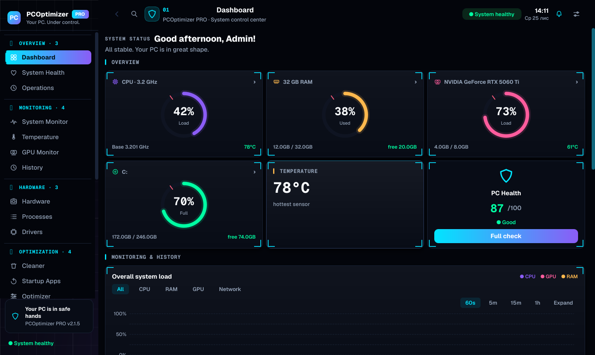 | 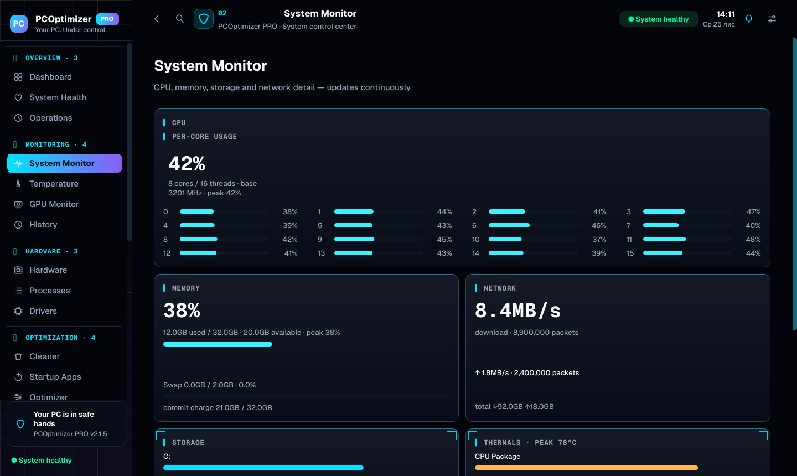 |

| Центр операцій | Панель температур |
| --- | --- |
| 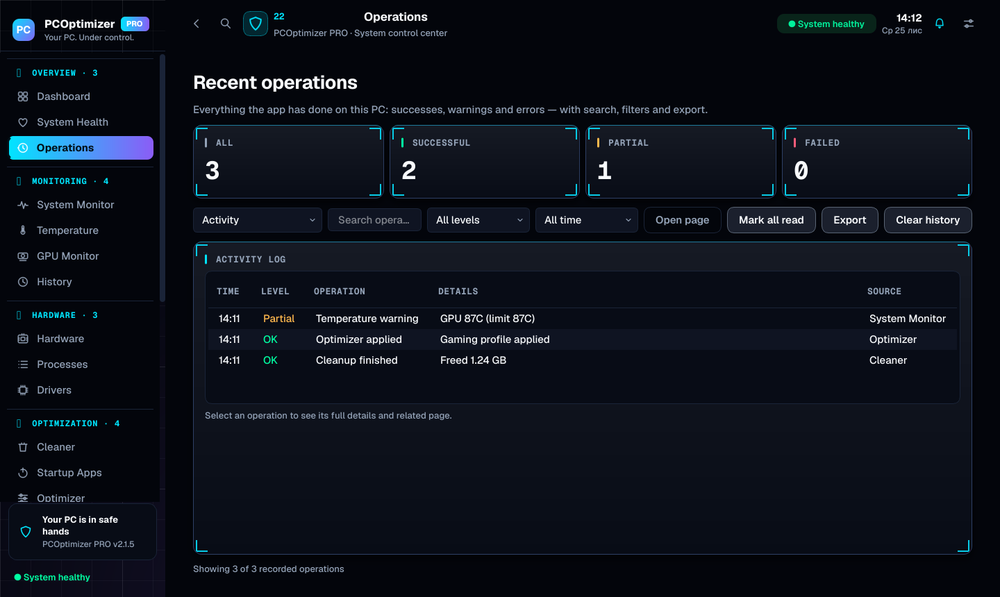 |  |

| Залізо (Hardware) | GPU-монітор |
| --- | --- |
| 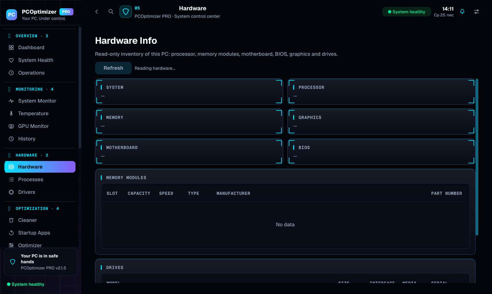 | 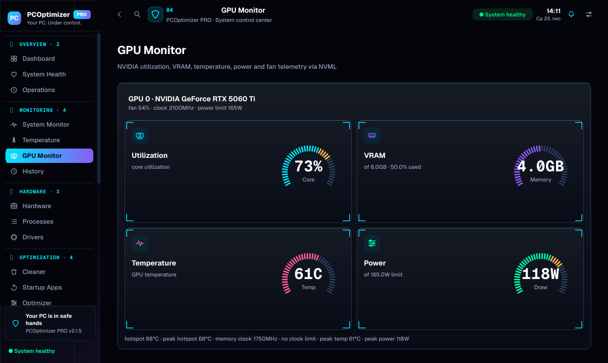 |

| PC Health Score | Чистильник |
| --- | --- |
| 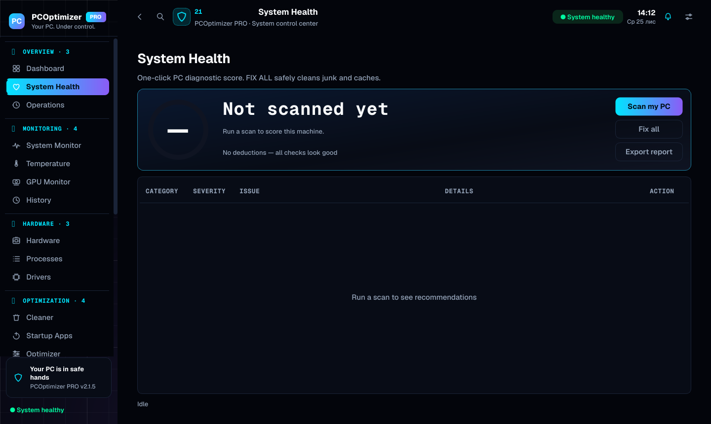 | 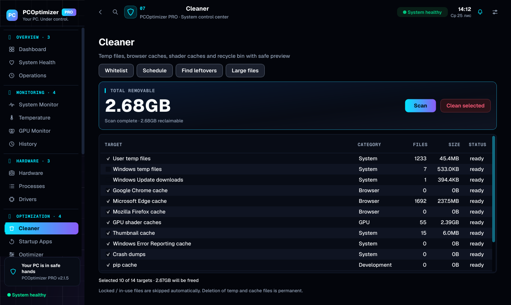 |

| Ігровий режим | Лаунчер ігор |
| --- | --- |
| 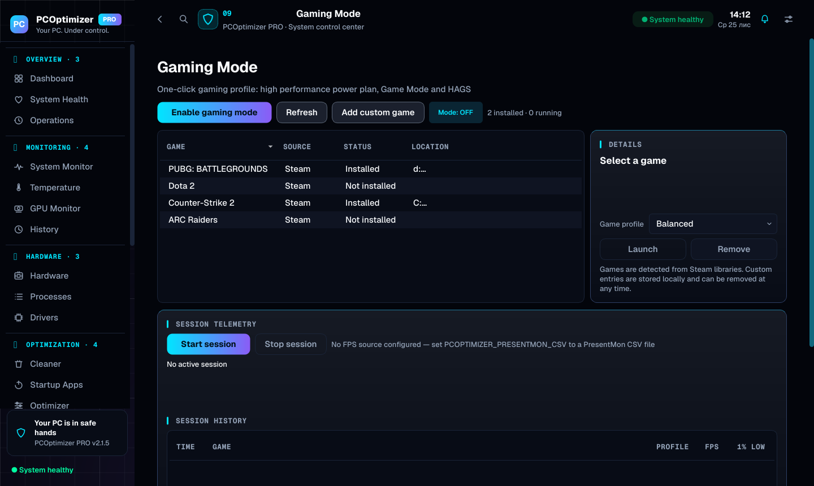 | 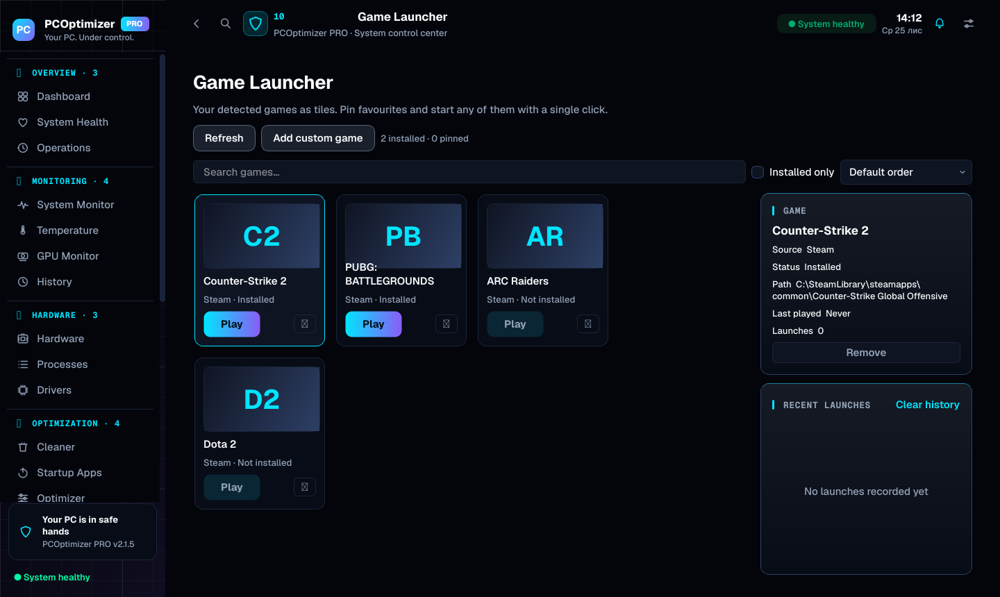 |

| Бенчмарки | Мережа |
| --- | --- |
| 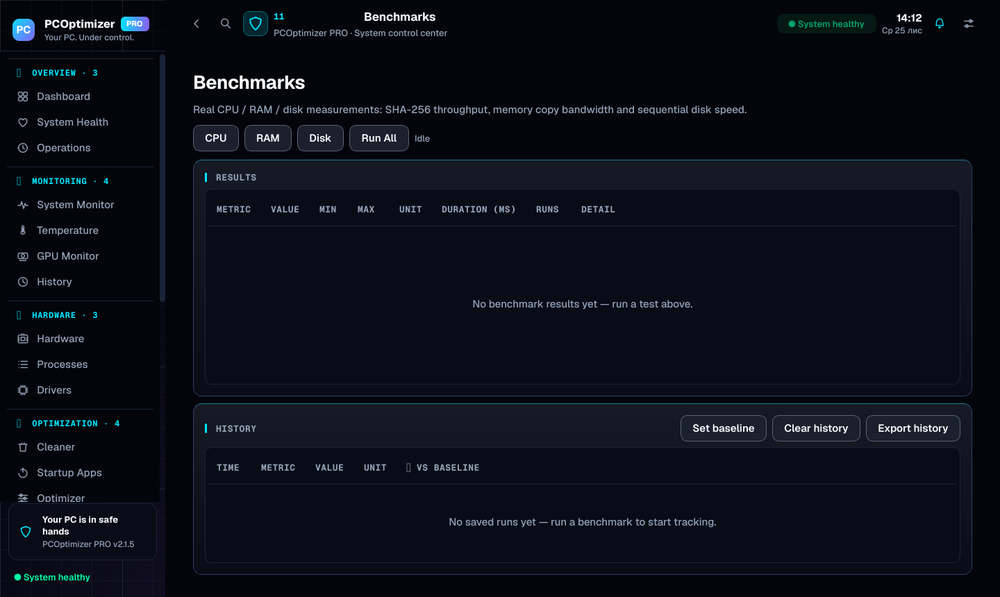 | 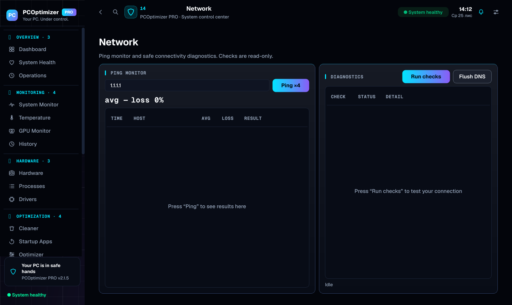 |

| Діагностика | Диски та сховище |
| --- | --- |
| 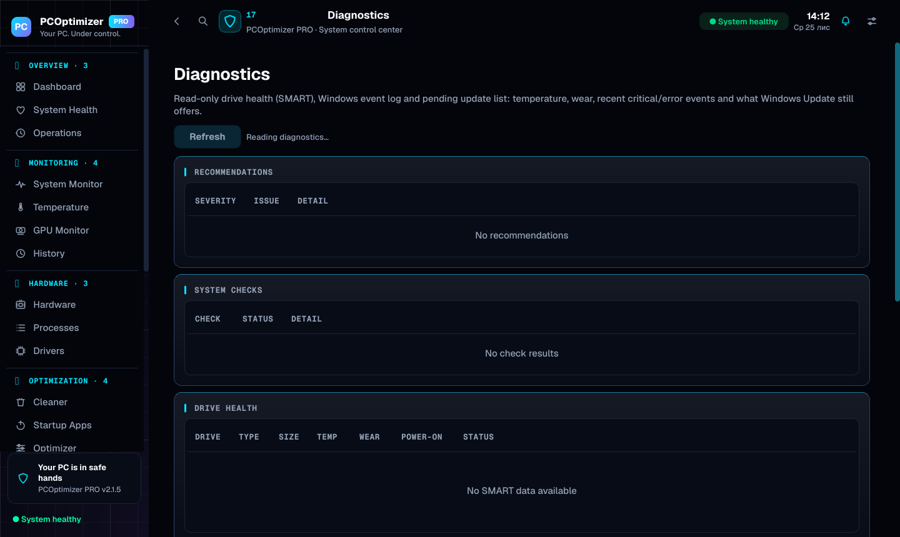 | 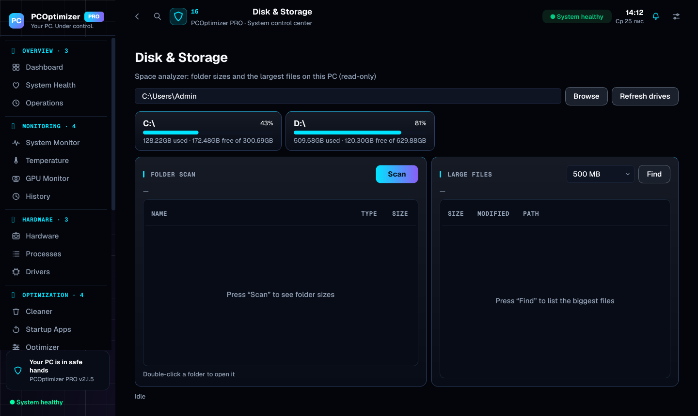 |

| Панель температур | Бенчмарк заліза |
| --- | --- |
|  | 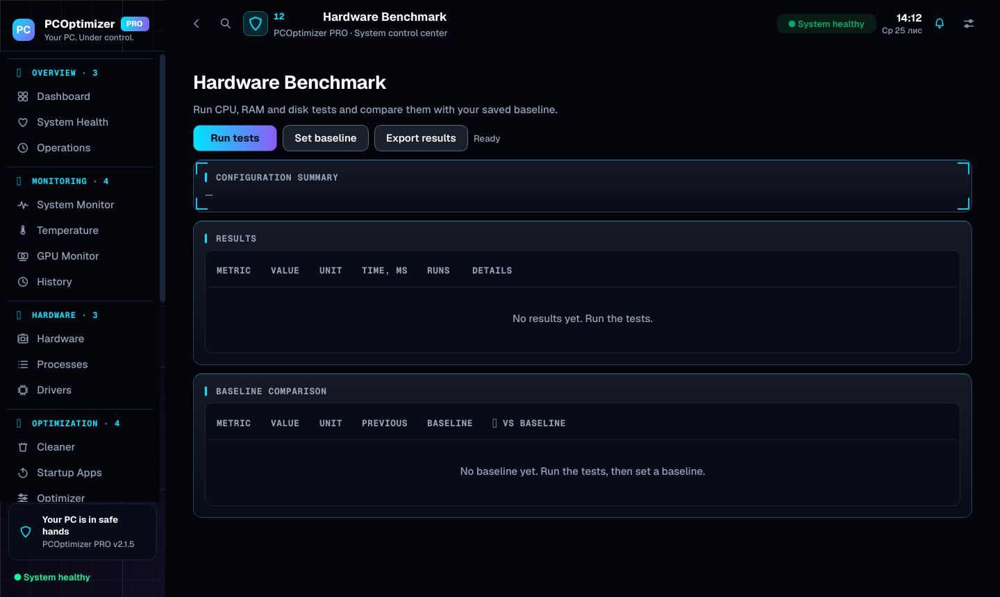 |

| Центр експорту | Драйвери |
| --- | --- |
| 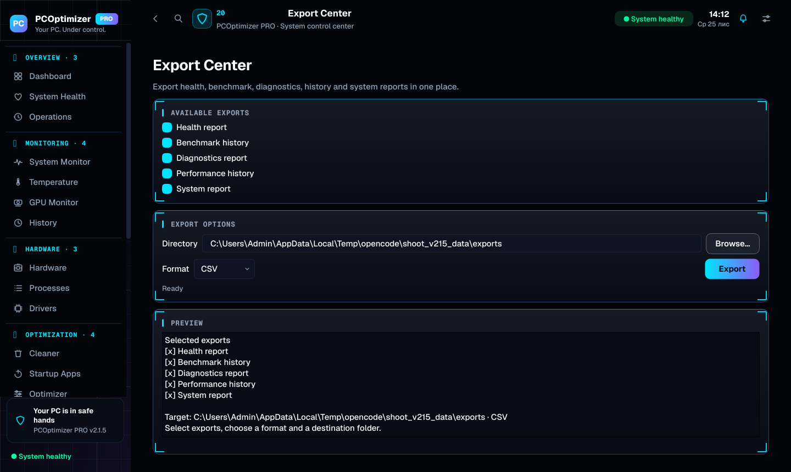 | 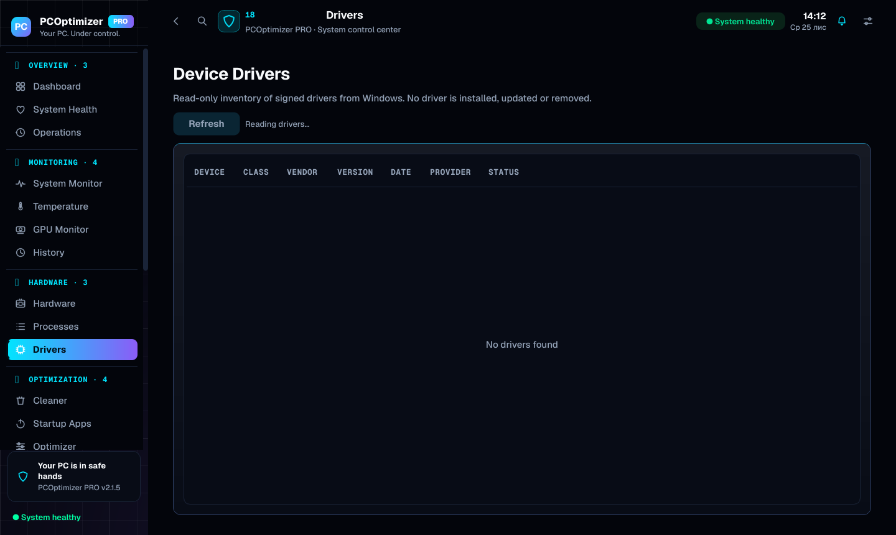 |

Решта сторінок (Процеси, Автозавантаження, Оптимізатор, Історія продуктивності, Звіт системи, Налаштування): [docs/screenshots](docs/screenshots)

---

## Технології

- **Python 3.13** + **PySide6** (Qt 6; 18 вбудованих тем, тема за замовчуванням — Titanium, вбудовані шрифти Geist / Geist Mono, масштаб інтерфейсу 100–150% із миттєвим застосуванням)
- **psutil** — CPU/RAM/диски/мережа, **nvidia-ml-py** (NVML) — GPU, **WMI** — температури, **pywin32** — COM/Task Scheduler/кошик, **pythonnet** + LibreHardwareMonitorLib — додаткові апаратні температури
- **pytest** — 980 тестів
- **PyInstaller** — збірка .exe, **Inno Setup** — інсталятор

## Безпека понад усе

- Ніяких «секретних» реєстрових твіків і псевдооптимізацій
- Кожна зміна: бекап → застосування → доступний відкат
- Точка відновлення створюється окремо, за вашим підтвердженням
- Застосунок працює без адмін-прав; UAC піднімається лише для конкретної операції
- Реальні виміри замість обіцянок «+100500 FPS»
- Незмінний журнал системних змін (Optimizer / Restore / Startup / Cleaner) у розділі «Операції», з перевіркою цілісності ланцюжка SHA-256 та контрольними сумами бекапів
- Виявлення некоректного завершення: маркер сесії оновлюється під час моніторингу, після чистого виходу видаляється, а після збою — повідомляє про це трей-сповіщенням і рядком у журналі операцій

## Встановлення

**Варіант 1 — інсталятор.** Запустити `PCOptimizer_PRO_Setup_2.1.5.exe`.
Встановлюється для поточного користувача (без прав адміністратора), мови EN/UA, створює ярлики та деінсталятор.

> Якщо Windows показує «Windows protected your PC» (SmartScreen) — це нормально для непідписаних програм: **More info → Run anyway**. Так само деякі антивіруси можуть хибно реагувати на PyInstaller-збірки.

**Варіант 2 — портативно.** Розпакувати `PCOptimizer_PRO_2.1.5_portable.zip` і запустити `PCOptimizer_PRO.exe` у корені архіву. Нічого не встановлюється.

Готові збірки — у розділі [Releases](https://github.com/dimaprisaznuk64/PCOptimizer_PRO/releases).

## Запуск з джерел

Потрібен Python 3.13 (Windows 10/11 x64).

```bash
pip install -r requirements.txt
python main.py
```

Тести:

```bash
pip install -r requirements-dev.txt
python -m pytest tests
```

## Збірка

```powershell
# .exe (PyInstaller, onedir) → dist\PCOptimizer_PRO\
powershell -ExecutionPolicy Bypass -File scripts\build_exe.ps1

# інсталятор (потрібен Inno Setup 6) → dist\installer\
powershell -ExecutionPolicy Bypass -File scripts\build_installer.ps1
```

## Структура проєкту

```
main.py                  — точка входу
app/
  ui/                    — PySide6 UI: 23 сторінки, теми, трей, topbar
  sensors/               — шар сенсорів: psutil / NVML / WMI / mock
  health/                — PC Health Score
  benchmarks/            — швидкі тести CPU / RAM / диска
  history/               — історія продуктивності (JSONL, графіки, топ процесів за RAM)
   reports/               — експорт звітів у CSV / JSON / PDF, Центр експорту + загальний звіт системи
   temperature/           — панель температур: live ACPI/NVML + історія
   drivers/               — інвентар драйверів (лише читання)
   diagnostics/           — SMART, події, системні файли, рекомендації

   alerts/                — температурні та resource-алерти (CPU/RAM/диск)
  cleaner/               — чистильник
  disk/                  — дисковий аналізатор
  gaming/                — ігровий режим, профілі ігор і сесійна телеметрія FPS
  network/               — ping і діагностика мережі
  optimizer/             — профілі оптимізації Windows
  processes/             — менеджер процесів
  startup/               — менеджер автозавантаження
  restore/               — бекапи та відкат
  settings/              — налаштування (дані в data/ поруч із exe)
  logs/                  — ротаційне логування
  i18n/                  — локалізація UA / EN
  core/, hardware/, monitor/, health/, diagnostics/, alerts/, benchmarks/, gaming/ — допоміжні модулі
tests/                   — pytest-тести (900+)
scripts/                 — збірка exe/інсталятора, генерація іконки
installer/               — скрипт Inno Setup
docs/screenshots/        — скріншоти
```

## Локалізація

Українська (основна) та англійська. Перемикається в Налаштуваннях і застосовується одразу, без перезапуску.

## Сумісність

- Windows 10/11 x64
- GPU-сторінки — для NVIDIA (NVML); без NVIDIA застосунок працює, а сторінки показують пояснення
- Адмін-права не потрібні; UAC — точково (HAGS, схеми живлення)

## Дорожня карта

- Overlay (FPS/CPU) поверх гри
